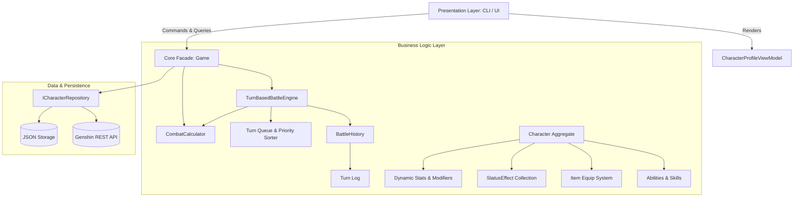
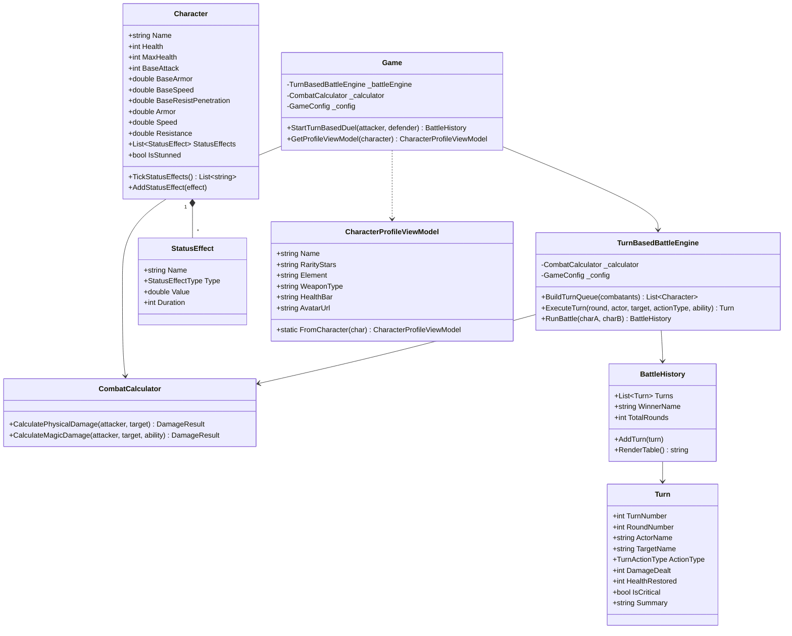

# Software Design Document (SDD)
## Subsystem: Business Logic Layer (BLL) & Turn-Based Combat Engine

**Project Name:** Modular Application Platform & RPG Character Engine  
**Module:** Business Logic Layer (Practical Work 14)  
**Architecture Style:** Clean Architecture (Domain-Driven, Decoupled BLL, Strategy, ViewModel)  
**Language & Platform:** C# 12, .NET 8.0, xUnit  
**Status:** Approved & Finalized  

---

## 1. Executive Summary & Purpose

The purpose of this document is to specify the architectural design, mathematical foundations, and component interactions of the **Business Logic Layer (BLL)** for the RPG character and combat platform.

The Business Logic Layer sits at the core of the application architecture, completely decoupled from Presentation concerns (CLI, graphical interfaces) and Infrastructure mechanisms (persistence, remote HTTP APIs). In this practical work, the BLL introduces:
1. **Deterministic Mathematical Combat Formulas:** Rigorous calculation of physical damage (with flat armor mitigation and effective resistance) and magic/ability damage (with additive scaling, resistance penetration, and proficiency factors).
2. **Turn-Based Tactical Battle Engine:** Speed-based dynamic timeline scheduling, turn queues with bonus action slots for high-agility characters, and complete round orchestration.
3. **Status Effect System:** Lifecycled temporal effects including Buffs, Debuffs, Damage-over-Time (DoT), and Stuns.
4. **Presentation ViewModels:** Decoupled data projection (`CharacterProfileViewModel`) preparing rich domain entities for rendering layers with formatted star ratings, element badges, and avatar URLs.
5. **Auditable Battle History:** Immutable step-by-step turn records suitable for tabular console rendering and audit replay.

---

## 2. High-Level Architectural Context



### Clean Architecture Boundaries
- **Domain Entities (`Character`, `Item`, `Ability`, `StatusEffect`):** Encapsulate intrinsic attributes and state transitions. No dependency on UI or storage.
- **BLL Services (`CombatCalculator`, `TurnBasedBattleEngine`):** Encapsulate domain rules, formulas, turn priorities, and combat simulation loops.
- **ViewModels (`CharacterProfileViewModel`):** Project domain aggregates into immutable, presentation-optimized structures without polluting entities with display formatting.
- **Application Facade (`Game`):** Orchestrates interactions between repositories, BLL services, and consumers.

---

## 3. Mathematical Combat Model

The combat subsystem implements deterministic formulas designed to prevent negative damage values, clamp resistance reduction, and handle additive/multiplicative modifiers cleanly.

### 3.1. Physical Attack Formula

Physical attacks resolve flat armor reduction followed by net resistance mitigation:

$$dmg_{phys} = \max\left(0, dmg_{flat} - armor_{tgt}\right) \times \max\left(0, 1 - \max\left(0, res_{tgt} - res_{pen}\right)\right)$$

Where:
- $dmg_{flat}$: Base flat physical attack value (attacker base attack + weapon flat bonus).
- $armor_{tgt}$: Effective armor of the target (base armor + item armor bonuses + active buff armor).
- $res_{tgt}$: Effective fractional elemental/physical resistance of the target ($0.0 \dots 1.0$).
- $res_{pen}$: Attacker's resistance penetration coefficient.
- $\max(0, \dots)$: Guards against negative damage and negative mitigation (heals from armor or over-capped resistance).

If a critical strike occurs ($P_{crit} \le \text{CritChance}$):
$$dmg_{phys, final} = dmg_{phys} \times \text{CritMultiplier}$$

### 3.2. Magic & Ability Attack Formula

Magic and ability attacks scale with flat ability bonuses, additive modifiers (items, skills, buffs), and are scaled by proficiency and ability debuffs:

$$dmg_{magic} = \left( dmg_{flat} \times \max\left(0, 1 - res_{tgt} + res_{pen}\right) + bonus_{flat} \right) \times \max\left(0.1, 1 + bonus_{prof} - debuff_{ability}\right)$$

Where:
- $dmg_{flat}$: Raw base spell or ability magnitude.
- $res_{tgt} - res_{pen}$: Net resistance of the target after penetration.
- $bonus_{flat} = \sum \left( bonus_{item} + bonus_{skill} + bonus_{buff} \right)$: Cumulative additive flat damage additions across active equipment, character passives, and active buffs.
- $bonus_{prof}$: Attacker's proficiency modifier (scaling multiplier from character mastery or rank).
- $debuff_{ability}$: Active ability debuffs reducing outgoing magical efficiency.
- $\max(0.1, \dots)$: Floor multiplier ensuring a spell never deals less than 10% base efficiency even under heavy debuffs.

---

## 4. Turn-Based Battle Engine & Speed Timeline

### 4.1. Speed-Based Turn Priority
Characters do not act in arbitrary order. Each round, characters are queued according to their effective `Speed`:

1. All living combatants have their effective speed calculated:
   $$\text{Speed}_{eff} = \text{BaseSpeed} + \sum \text{ItemSpeed} + \sum \text{BuffSpeed} - \sum \text{DebuffSpeed}$$
2. Combatants are sorted descending by $\text{Speed}_{eff}$.
3. **High-Speed Advantage (Bonus Action Slot):**
   If $\text{Speed}_{fastest} \ge 1.5 \times \text{Speed}_{slowest}$, the fastest combatant receives an additional action slot in the round's queue:
   $$\text{Queue} = \left[ C_{fastest}, C_{slowest}, C_{fastest} \text{ (Bonus Action)} \right]$$

### 4.2. Turn Execution Lifecycle

Each turn follows a strict 5-stage lifecycle:

```mermaid
sequenceDiagram
    autonumber
    participant Engine as TurnBasedBattleEngine
    participant Actor as Character (Actor)
    participant Calc as CombatCalculator
    participant Target as Character (Target)
    participant History as BattleHistory

    Engine->>Actor: TickStatusEffects()
    Note over Actor: DoT applied, Stuns/Buffs duration decremented
    
    alt Actor is Stunned
        Engine->>History: AddTurn(TurnActionType.Skip, "Actor is stunned")
    else Actor is Active
        Engine->>Calc: CalculatePhysicalDamage() or CalculateMagicDamage()
        Calc-->>Engine: Resolved Damage & Crit Flag
        Engine->>Target: TakeDamage(dmg)
        opt Ability applies StatusEffect
            Engine->>Target: AddStatusEffect(effect)
        end
        Engine->>History: AddTurn(Round, Actor, Target, dmg, log)
    end
```

1. **Status Tick Stage:** Prior to acting, the actor's active status effects are processed via `Character.TickStatusEffects()`:
   - Damage-over-Time (DoT) deals direct health damage.
   - Durations are decremented by 1. Expired effects are purged.
2. **Incapacitation Check:** If `Actor.IsStunned` is `true`, the turn is forfeited immediately, generating a `TurnActionType.Skip` record in `BattleHistory`.
3. **Resolution Stage:** The actor selects an action (Attack, Ability, or Heal). `CombatCalculator` evaluates damage or healing deterministically.
4. **State Transition Stage:** Damage is applied to the target. Status effects attached to the ability (e.g., Burn DoT or Stun) are transferred to the target's active effects collection.
5. **Audit Stage:** A `Turn` record is constructed and appended to `BattleHistory`.

---

## 5. Status Effects Subsystem

Status effects implement temporal modifications to character stats and combat state:

```csharp
public class StatusEffect
{
    public string Name { get; set; }
    public StatusEffectType Type { get; set; } // Buff, Debuff, DamageOverTime, Stun
    public double Value { get; set; }
    public int Duration { get; set; }
    public string Description { get; set; }
}
```

- **Buff:** Increases Armor, Speed, or Attack by `Value`.
- **Debuff:** Decreases target Armor, Speed, or Attack by `Value`.
- **DamageOverTime (DoT):** Deals `Value` damage to HP at the beginning of each turn.
- **Stun:** Sets `IsStunned = true`, causing actor to skip active turns until expired.

---

## 6. Character Profile ViewModel

To preserve presentation decoupling, the domain model `Character` is never bound directly to CLI or UI widgets. Instead, `CharacterProfileViewModel` projects domain state:

- **Rarity Stars:** Converts numerical rating ($1 \dots 5$) into Unicode star glyphs (`★★★★★`).
- **Effective Stats Summary:** Summarizes base attributes, gear bonuses, and active effect offsets into formatted display strings.
- **Metadata Badges:** Resolves element symbols, weapon categories, and avatar CDN URIs (e.g. Genshin Dev API assets).

---

## 7. Class Structure & Relationships



---

## 8. Verification & Test Suite

The Business Logic Layer is validated via 13 exhaustive unit tests in `Tests/BusinessLogicTests.cs`:
1. `CombatCalculator_PhysicalDamage_AppliesFlatArmorCorrectly`
2. `CombatCalculator_PhysicalDamage_AppliesResistancePenetration`
3. `CombatCalculator_MagicDamage_AppliesProficiencyAndBonusFlat`
4. `CombatCalculator_MagicDamage_ClampsDebuffAtMinimumMultiplier`
5. `CombatCalculator_CriticalStrike_MultipliesDamage`
6. `Character_DynamicStats_AccountForItemsAndStatusEffects`
7. `Character_StatusEffects_TickDecrementsDurationAndPurgesExpired`
8. `Character_DamageOverTime_DamagesHealthOnTick`
9. `TurnBasedBattleEngine_SpeedTimeline_HighSpeedGainsBonusAction`
10. `TurnBasedBattleEngine_StunnedCharacter_SkipsTurn`
11. `TurnBasedBattleEngine_SimulateFullBattle_DeclaresWinner`
12. `BattleHistory_RenderTable_ProducesNonEmptyAsciiTable`
13. `CharacterProfileViewModel_MapsRarityStarsAndMetadata`

---

## 9. Conclusion

The implemented BLL fulfills all requirements of Practical Work 14:
- Decoupled, robust, and unit-tested business logic.
- Mathematical precision matching exact domain formulas.
- Turn-based tactical simulation with dynamic speed timeline.
- Complete presentation ViewModel decoupling.
